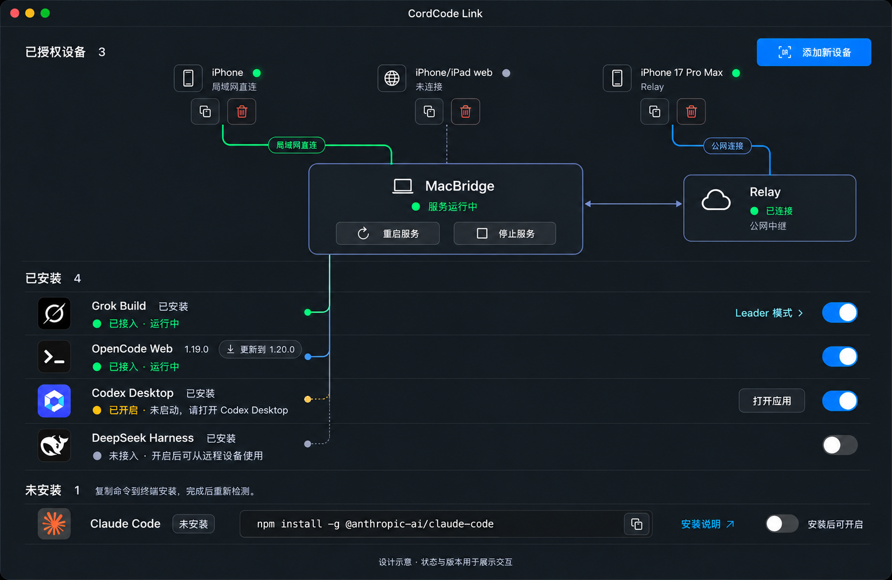

# CordCode Link：设备—服务—Agent 拓扑与接入状态管理

日期：2026-10-15（Asia/Taipei）
版本：v2，补充 Magpie 源码复用；方案待独立评审；本次只交付方案与证据，不修改产品代码。
目标分支：`feat/ios-native-message-timeline`。

## 1. 目标与开发入口

用一页完成三件事：看清已授权设备当前是否连接、控制 MacBridge 服务、逐个管理 Agent 的接入。解决启动 App 后默认注册全部驱动，以及“安装了”“能接入”“正在运行”“有更新”混为一个“就绪”的问题。

开发者按 §10 的 S0→S7 实施。方案评审通过是项目规定的开发入口；本文不是已经通过的评审，也不扩大真实账号、UI automation 或生产部署的授权。未来实施先重新核对来源，不能把本文的 HEAD 当作当时工作树身份。

### 1.1 已确认需求

| ID | 交付行为 |
| --- | --- |
| R1 | 14 寸 MacBook Pro 常见 1512×982 逻辑屏幕比例；工作站内容随窗口铺开，不再限制在 1016pt 窄列。 |
| R2 | 上：已授权设备；中：MacBridge 与侧边 Relay；下：已安装／未安装 Agent。只保留一处服务状态与控制按钮。 |
| R3 | 删除“AI 工具／只接入你开启的工具”整行、全部表头与表格竖线；连接拓扑的连线不属于表格分隔线。 |
| R4 | 设备名称后：已连接为呼吸绿点，未连接为静止灰点。设备下方两个图标按钮，悬停分别显示“复制配对链接”“移除设备”。 |
| R5 | 蓝色配对主按钮改名“添加新设备”，放在设备区；移除沿用撤销授权语义。 |
| R6 | 当前版本旁显示“↓ 更新到 x.y.z”小按钮；更新与安装、可用状态分别表达。 |
| R7 | 未安装 Agent 的名称、命令、复制按钮、安装说明同一行；安装后不会自动开启接入。 |
| R8 | 接入开关真正控制驱动注册、订阅、扫描与托管进程入口，而不是仅隐藏工具行。显式选择持久化。 |
| R9 | 全部 Agent 关闭仍可启动桥接服务、添加设备、保持已授权设备连接；客户端显示“尚未启用 Agent”。 |
| R10 | 区分失败、检测中、未知／过期；不把检测失败报成未安装，不把配置完成报成已连接。 |

非目标：更换 backend、改变官方 Remote Control／ACP／Web API、改变 Relay-first + opt-in LAN 策略、改写 session/turn/SSV2、部署 Relay、增加第六个 Agent、引入自动安装更新。既有安装器和专用设置能力保留，不重写其授权和失败语义。

### 1.2 设计稿与文字的优先级



图用于布局、信息层级和控件形态；图里的设备、在线状态、版本号与图标是示意。**本文状态规则高于示意图**：例如图里的 OpenCode `1.20.0` 不是真实更新；本轮 npm 样本的 latest 是 `1.19.0`。CLI 按需执行的 Claude/Grok 不以“有一个常驻 AI 进程”作为可用条件。生产界面必须使用项目实际品牌资源，不能照抄生成图中的近似图标。

v2 变化：将安装与版本查询统一归 Go `toolinventory`，取消拟新增的 Swift `AgentVersionService`；借鉴 Magpie 安装来源识别、同 scope 命令、请求去重及对应测试，保留 CordCode 独立状态轴与安全重启。具体处置、许可证和源码调用链见 [Magpie 源码复用调查](2026-10-15-magpie-agent-management-source-reuse.md)。R/OD/E/S 的 ID 与产品范围不变。

## 2. 来源冻结与事实调查

### 2.1 v1 完整来源清单（历史冻结，未回写）

来源门 1（源码分析前）和门 2（首次文档修改前）均在本轮重新执行 `git worktree list --porcelain`、`git branch --show-current`、`git rev-parse HEAD`、`git status --porcelain`。对应身份相同。所有未提交路径逐项保存在 [source-manifest.json](assets/2026-10-15-agent-management/source-manifest.json)，不能只看下面的计数。

| 别名 | 绝对工作树路径 | 分支 | 完整提交 | 本轮首次编辑前未提交状态 |
| --- | --- | --- | --- | --- |
| M | `/Users/jacklee/Projects/cordcode-macbridge-native-message-timeline` | `feat/ios-native-message-timeline` | `f7dee495ccf722ce66e4cd470bf795ec5332893c` | 干净 |
| I | `/Users/jacklee/Projects/cordcode-ios-native-message-timeline` | `feat/ios-native-message-timeline` | `e479378f8c88338219ad734a7571e41ade356575` | 274 项已有修改／未跟踪，均在 `docs/` 与 `.exec-plan/`；完整路径见 manifest；本轮不修改、不提交这些文件 |
| U-Codex | `/Users/jacklee/Projects/codex` | `main`，只读上游 | `cc7ba33601286a751477832b01de7b6f8de0dd9c` | 干净 |
| U-Grok | `/Users/jacklee/Projects/grok-build` | `main`，只读上游 | `2bdd1d6a6369de0e8c68132ea4539e9abd9e14a8` | 干净 |
| U-DSH | `/Users/jacklee/Projects/deepseek-harness` | `master`，只读上游 | `d743267388641bc76f17c45ce8b4c231aed1d32c` | 干净 |
| U-OpenCode | `/Users/jacklee/Projects/opencode` | `dev`，只读上游 | `0d61729b3fa005cec9aa754c075a809663c736a4` | 干净 |

任务预期来源：M/I 上述功能工作树；配套依据是本轮枚举的唯一同分支族，并复核 M 的 `docs/2026-10-06-opencode-web-install-and-start-plan.md` §0 已记载同一配对路径。旧文档只提供配对线索，旧提交没有沿用。预期产品身份：`claude`（wire `claude_code`）、`codex-remote`、`grokbuild`、`dsh-web`（wire `deepseek-web`）、`opencode-web`；显式接入、direct/Relay 在线观察、零 Agent 可连接。

已经阅读 M/I 两份 `CLAUDE.md`、M 的 `BUILD_INSTALL_AND_RUNTIME.md`／`GO_BRIDGE_ARCHITECTURE.md`、I 的 `IOS_MAC_INTERACTION_FLOW.md`，并检索两仓 `think.md`。本轮只读源码与版本信息，无 build/test/install、UI automation、运行时重启或账号配对。没有把本地源码身份认作 `/Applications` 中正在运行的产品身份。

### 2.2 真实版本与上游边界

[local-cli-versions.json](assets/2026-10-15-agent-management/local-cli-versions.json) 是本轮有 5s 上限的只读版本探针：Claude `2.1.296`、Grok `1.0.52 (0920c8169e27)`、dsh `0.2.0-rc.2`、OpenCode `1.19.0`。本轮读取 ChatGPT app 的 Info.plist：版本 `26.1007.30912`、build `20156`；它不是 npm Codex CLI 的版本。

上游 checkout 与这些发布二进制**不是同版本证明**。Grok 的 `0920c8169e27` 在本机 checkout 无可解析提交；OpenCode checkout 是新版 dev 树，不能据它为已安装 1.19.0 发明参数。本方案不修改上述产品内部状态机；上游源码用于确认行为边界，版本解析以本轮真实输出为准。若实施扩大到官方协议、升级执行或新 flags，先取得对应目标版本来源和真实样本，不能沿用本表作放行。

### 2.3 可复用实现与实际缺口

以下锚点全部属于上表对应提交。行号仅用于定位，符号为核验主体。

| 能力 | 源码事实／锚点 | 复用与扩展 |
| --- | --- | --- |
| 工作站与布局 | M `Views/WorkspaceView.swift:14,73`（路径前缀 `MacBridge/MacBridge/`）；`Views/Components/LayoutConstants.swift` 的 `workspaceFocusedContainerWidth=1016`；`PageContainer.pageContent` | 重排现有工作站，移除本页宽度上限；不复制第二个首页，不改变其他 sheet 的宽度。 |
| 默认驱动 | M `Services/RuntimeManager.swift:158,206,1644` 的 `RuntimeConfig`、`processArguments`；`App/AppDependencies.swift:126` 未传用户选择 | 从单一选择 store 生成 `drivers`，显式空集也传 argv；不是从安装检测结果生成。 |
| 驱动即有后台行为 | M `go-bridge/main.go:202,232,274` 的创建、注册与订阅；`agent/codex-remote/agent.go:76` 自动恢复 pairing；`agent/dsh-web/dshweb.go:126` 的后台解析 | 接入关闭必须阻止这些入口执行；不调用 `New` 来仅仅检测安装。 |
| 零驱动当前失败 | M `go-bridge/main.go:286` 的空 BackendList 退出；`management_api.go:462` 已有 `ready_no_agents` | 区分主动空集与非空请求全部创建失败；前者启动，后者保留真实错误。 |
| 安全重启 | M `Services/RuntimeManager.swift:412,431,463,677`：generation、`applyConfigAndRestart`、quiesce/commit | 复用现有 admission 与代际校验；补选择应用 outcome，不能新增旁路 `kill` 或自动强制重启。 |
| 管理面实际状态 | M `go-bridge/agent_descriptor.go:19,162,211`；`management_api.go:649,661,1265` | 保留 wire readiness，新增本机 workspace snapshot；安装／版本探测与活动 driver readiness 分开。 |
| 设备授权与撤销 | M `ViewModels/DeviceStore.swift:17,99`；`management_api.go:901,917` | 保留 revoke→强制 reload→警告矩阵；只是更换呈现与文案。 |
| 当前在线连接 | M `go-bridge/device_conn_registry.go:14,35,67`，direct 在 `server.go:626` 注册，Relay 在 `relay_bridge_client.go:551` 注册；`:381` 清掉死连接 | 扩展同一 registry 的只读 transport snapshot；不新建第二套判活注册表，不用 lastSeenAt 猜在线。 |
| 配对链接 | M `WorkspaceView.swift:443` 的 `handleCopyLink`；`ViewModels/PairingViewModel.swift:129` 的 `getOrFetchWebPairingURL` | 保留创建／复用官方 `/web/` 配对 URL；这是邀请入口，**不是恢复这台设备旧 token**。 |
| Grok Leader | M `Services/GrokLeaderModeManager.swift`、`WorkspaceView.grokLeaderToggle/grokLeaderHint` | “Leader 模式 ›”展开已有专用状态机；接入开关不写 Grok 配置。 |
| 安装定位 | M `agent/dsh-web/binary.go:44` 的 record→PATH→nvm；`Services/OpenCodeManagedServer.swift:51` 的 `DefaultOpenCodeCLIResolver`；`OpenCodeInstaller.swift:85` 的安装记录；`agent/codex-remote/chatgpt_auth.go:20` 的 app 内嵌路径 | 扩展纯定位 seam；Codex 检测 app/内嵌 CLI，不拿 `command -v codex` 当 Desktop 安装条件。 |
| 空后端客户端边界 | I `Services/Bridge/BridgeProvider.swift:948,1204`（前缀 `OpenCodeiOS/OpenCodeiOS/`）拒绝空数组；I `remote-web/src/app/AppController.ts:1079,1094` 强制选后端，`core/backend/backend-selection.ts:19` 空数组抛错 | 必须同步修复初连与重连；保持 transport online，清除旧 client，不把空集当断网。 |
| 客户端呈现与发送边界 | I `OpenCodeiOS/OpenCodeiOS/App/OpenCodeiOSApp.swift:566` 的 `syncBridgeTargets` 对recognized空集直接return；`ViewModels/ServerViewModel.swift:782` 只upsert、不清旧激活；web `adapter/RemoteWebViewModel.ts:114` 已支持activeBackendId为null，`core/backend/backend-selection.ts:14` 仅排除unavailable/disabled | 补App级connected/noAgents呈现与旧target停用；web选择严格认available，不能把not_detected/service_not_running选成可发送工具。 |
| 空数组序列化 | M `go-bridge/hello_handler.go:44` 的 `backends,omitempty`；`:168` 构造列表；`hello_handler_test.go:126` 仅验证 Go 内存非 nil | 成功 ACK 明确发送 `backends: []`；补实际 JSON 序列化测试，失败 ACK 仍按错误契约。 |

上游核验：U-Codex `codex-rs/app-server-transport/src/transport/remote_control/desired_state.rs:12` 与 `app-server/src/request_processors/remote_control_processor.rs:63` 将愿望态和实际状态分开，官方 disable 会修改其持久配置；CordCode 接入关闭**不调用这个官方 disable**。U-Grok `crates/codegen/xai-grok-update/src/auto_update.rs:167,228`／`auto_update_tests.rs` 与 `xai-grok-pager/src/app/cli.rs:89` 定义只检查更新及 channel/policy；U-OpenCode `packages/cli/src/commands/handlers/upgrade.ts:18`／`test/upgrade.test.ts:19` 按安装方式升级、检查失败不安装；U-DSH `apps/cli/src/bin.ts:27`→`args.ts:146` 与 `tests/args.spec.ts:92` 定义版本入口。

闭源 Claude 的本轮命令证据：`claude install --help` 输出 `install [options] [target]`，target 可为 stable/latest/具体版本。已安装 OpenCode 1.19.0 的 `upgrade --help` 证明 `[target]`、`--method`、`--major`；本方案不传 `--major`。CLI 安装／更新元数据实际来源见 §7 与伴随样本审计，不能以 SDK 类型代替这些证据。

### 2.4 产品覆盖底表

枚举线：M 的 RuntimeConfig 产品声明 → `main.go` blank imports／aliases／实际注册 → M 管理面和 I 初连／重连消费。结果是 **5 个产品 Agent**。CLI 无 Swift 参数时的六驱动默认含 legacy，并不等于六个正式产品。旧 `codex`、`codex-web`、`opencode`、`deepseek` 不纳入本页，不能因它们在 core 注册表可见而重新上市。

| 产品 ID / wire kind | 安装与操作模型 | 接入后实际可用的含义 | 处置 |
| --- | --- | --- | --- |
| `claude` / `claude_code` | CLI；每 session 按需启动 | CLI 可调用；不声称存在全局常驻 Claude 进程／已完成登录 | 支持；已有更深诊断保留 |
| `codex-remote` / 同名 | ChatGPT Desktop + 已有独立 controller pairing | 官方 environment stream 已绑定；本机 App 在运行不等于链路可用 | 支持；沿用五态 readiness 与配对 sheet |
| `grokbuild` / 同名 | CLI；catalog/ACP/session 按既有生命周期 | adapter 可用、按需执行；Leader 模式独立 | 支持 |
| `dsh-web` / `deepseek-web` | CLI + 官方 seat；沿用显式启动 | 已解析实例、可访问；未启动时有“启动服务”入口 | 支持，不恢复自动冷启动 |
| `opencode-web` / 同名 | Swift managed serve 或已配置 external HTTP | 官方实例探针可用；本机 CLI 存在不等于实例运行 | 支持，不改变 server-source 设置 |
| legacy 与 app-server 库 | 非本页产品 | 不适用 | 排除，原因见上文 |
| Relay server | 公网密文中继，不是 Agent | Mac Relay transport connected | 只观察；不新增 VPS 控制接口 |

### 2.5 v2 Magpie 来源与复用门

本轮首次修订前重新核对：M `/Users/jacklee/Projects/cordcode-macbridge-native-message-timeline`，分支 `feat/ios-native-message-timeline`，提交 `2d9836247f8ce2dbda3afd81d1b821aadaccf4ea`，干净；I `/Users/jacklee/Projects/cordcode-ios-native-message-timeline`，同分支，提交 `e479378f8c88338219ad734a7571e41ade356575`，既有274项 docs/.exec-plan dirty；G `/Users/jacklee/Projects/magpie`，分支 `main`，提交 `a36319d607d97e4754e025b82070a32d1d1a58ac`，仅7个未跟踪 `.DS_Store`。各路径逐项未提交状态、worktree 元数据和引用文件 SHA 见 [v2 source manifest](assets/2026-10-15-agent-management/magpie-reuse-source-manifest.json)，G 全部 dirty 亦展开在复用调查 §1。

预期 M/I 配对、分支和5产品身份仍为 §2.1 所列；G 为用户指定的只读参考，不是产品配套仓。M 的新提交只增加 v1 文档与证据，未改变 §2.3 的产品源码锚点。v2 不重新声称已安装产品或截图中 Magpie 的运行版本与 checkout 一致。v1 raw 样本及审计保持原采集身份。

G 复用：`internal/agent/cliupdate.go` 的 `howInstalled/fromNodeModules/installedVersion`、`internal/proc/version.go` 的低成本元数据、`probe.go` 的取消拥有权及其定向测试。界面借 `app.js` 的 `cliTag/paintCLI/paintInstalls`，连线借 `routing.js:1021 layout` 的真实几何；详细实际调用与测试归属见复用调查 §2。不跨模块 import G 的 internal 包，不搬其配置 wiring、静默错误、自动 Node 安装／upgrade repair 或备用更新源。正式抽取代码时遵守 MIT 版权与分发许可。

## 3. 界面与拓扑契约

### 3.1 页面与尺寸

保持原生暗色、现有 toolbar/设置/诊断入口。工作站不再新增 sidebar；本次不删除 App 原有导航能力。基准 1512×982 是逻辑尺寸比例，不是截图像素换成 point。窗口可缩放，不强制用户进入全屏，不越过菜单栏或 Dock。

工作站容器取实际可用宽度，两侧各 30–40pt；不再用 `workspaceFocusedContainerWidth` 截断。基准窗口三层与 5 个工具一屏可见：设备区域约 130–160pt，中间路径和服务约 200–230pt，Agent 正常行 64–72pt。最终按真实 toolbar、safe area 和字体校准；不为贴合图片硬编码全屏坐标。沿用最小窗口 1280×840；不足高度允许纵向滚动，禁止裁掉按钮。

设备 1–3 个横排、每个两行高度：名称／状态点及短路径文案在上，两个按钮在下；添加按钮在该区右侧。超过可用宽度按稳定 deviceId 顺序换成多行设备组，保留每组的两行结构；不隐藏设备或假装只有 3 台。长名称截断并 `.help` 全名；重名保留现有 ID 后缀。0 台显示真实空态与添加入口，设备 API 失败显示错误／重试，不能用空态代替错误。

### 3.2 设备点与线

绿点的条件：当前 runtime identity 下，该设备至少一条认证连接仍在现有 registry 中。direct／Relay 都算；匿名请求、待审批配对、仅保存的设备 token 不算。灰点不呼吸。未能获得当前快照时仍用灰点，但 tooltip 必须写“连接状态未知／无法获取”，与有证据的“未连接”区分。

在线绿点直径 8pt；中心常亮，仅外晕透明度／尺度缓慢变化，周期约 2s。减少动态效果开启时用静止绿点。hover/accessibility 提供“已连接：局域网直连／Relay／直连”或“未连接”；状态不能仅靠颜色表达。

路径来自连接实例 metadata，不能从 `preferLocalNetwork`、device.RelayEnabled、保存 URL 或 `lastSeenAt` 推断。单个设备可能短时同时有 direct 和 Relay：显示“切换路径中／多条连接”，画两条实际连接，不猜客户端最终赢家。direct 若无法证明是 LAN，文案为“直连”；Tailscale、安全 remote 仍走直连边，显示实际类别，不冒充 LAN。

设备→MacBridge 表示 direct；设备→Relay→MacBridge 表示 Relay。Relay connected 不等于任一设备在线。MacBridge→Agent 的实线表示 adapter 当前已接入且可用，不表示正在生成回答。已开启但未启动用淡虚线；关闭接入和未安装没有有效连接线。图中的 DeepSeek 灰虚线仅是示意，生产关闭态不画连接。

在根容器单一命名 coordinate space 使用 anchor preference 收集 device/service/agent 端点，用一个 background Canvas 绘制圆角折线；绘图禁用 hit testing。数据使用稳定 deviceId/backendId，线不能盖住文字、命令或按钮。窗口缩放、设备重排、长错误文案展开时重新计算几何，禁止按图片像素固定连线。除在线点外，不新增流动粒子动画。

### 3.3 中间服务区与 Agent 区

MacBridge 是主要节点；Relay 位于侧边，两者状态独立。运行态显示重启／停止；已停止显示“启动服务”；启动或停止中显示过程，禁用重复动作；失败显示原因与重试。Relay 只显示已关闭／未配置／连接中／已连接／未连接／未知，不提供会被误认成 VPS 重启的按钮。

工具无表头、无表格竖线，名字与当前版本第一行，接入/实际状态和原因第二行。更新 pill 紧跟版本。行右侧只有必要动作和接入开关；Grok 的“Leader 模式 ›”展开专用选项，不出现泛化“设置”。

分组：安装明确存在进“已安装”，明确缺失进“未安装”；检测中／检测失败保留上一次**已注明过期的分类**，无先前事实则放单独“待检测”小组，不能冒充未安装。已配置且无需本地 CLI 的 external HTTP 服务放条件出现的“已配置的外部服务”组，说明“使用外部服务，本机无需安装”；该组是对现有 source 模式的保留，默认本地场景仍只有两组。

各组内按固定产品顺序 `claude,codex-remote,dsh-web,grokbuild,opencode-web` 排序，不按最近一次请求完成顺序抖动。示意图的安装组合与顺序不构成真实机器要求。

未安装行：名称→未安装→等宽命令框及复制图标→安装说明→禁用接入开关；命令在基准窗口同一行。命令不截断而隐藏后半段；小窗口可在命令框内横向滚动，不把命令拆成多条。无 CLI 安装命令的 Codex Desktop 显示“下载 ChatGPT Desktop”官方链接，不用 `npm install @openai/codex` 替代 Desktop。

## 4. 状态所有权与数据模型（拟议）

### 4.1 独立状态轴

不使用一个包含所有组合的大 enum；组合成行 presentation。`available` 不是 `runningTurn`，`installed` 不是 `enabled`。

| 轴 | 状态 | 唯一拥有者／依据 |
| --- | --- | --- |
| 安装事实 | checking / installed / missing / notRequired / failed | Go 只读 inventory probe；路径、可执行文件／App、版本探针；版本失败仍可安装存在 |
| 用户意愿 | enabled / disabled + revision | Swift `AgentSelectionStore`，唯一持久化 writer |
| 应用过程 | inSync / applying / deferred / failed | RuntimeManager 选择应用 coordinator；当前 runtime identity、selectionRevision 与实际注册集合 |
| adapter readiness | inactive / checking / available / needsLogin / needsPairing / serviceNotRunning / notConfigured / portConflict / versionUnsupported / permissionDenied / failed | 活动 driver 的已有 descriptor 与 seat-action；disabled 不构造 driver |
| 版本状态 | unchecked / checking / current / updateAvailable / failed / unsupportedSource | Go `toolinventory.VersionService`；对应发行源、channel、实际版本样本 |
| 用户动作 | idle / starting / installing / error | 原 seat-action/installer manager；复制命令只改变 copied 状态 |
| 设备连接 | unknown / disconnected / connected(transports) | 现有 DeviceConnRegistry 的同源只读快照 |

安装 missing 仅由定位结果证明；版本命令 timeout、权限不足、无效输出属于 version/probe failed。卸载发生在用户仍 enabled 时，保留用户意愿，行显示“已开启 · 工具已卸载”，不能偷偷把偏好关掉。该行开关允许关回去，但不能从 disabled 打开。

### 4.2 复用与拟新增组件

- `AgentSelectionStore`（Swift，新）：dataDir 内单一 `agent-selection.json`，内容 `{schemaVersion:1, revision, enabledIDs}`，ID 是 runtime ID，不是名字。沿用项目原子文件写入模式：同目录临时文件→完整写入/flush→原子 rename，文件0600、目录0700；成功后重新读取验证，再发布内存意愿和发起应用。不能以 UserDefaults 的内存读回代替持久化成功证据。失败不改变内存意愿、不发重启；损坏／未知 schema 保留原文件、暴露错误并禁止自动挂载，不静默覆盖成默认。
- `ProductAgentCatalog`（Swift，新）：5 个产品的静态名称、图标、官方安装说明、显示顺序；**不存 capabilities 或可用状态**。可复用项目已有品牌组件。Go inventory 使用同一组产品 ID 的显式 catalog，契约测试对账两边集合，不能枚举全部 core 注册项作为产品。
- `go-bridge/workspace_snapshot.go`（新）：从现有 owning sources 汇总本地管理快照，包含全产品 inventory、活动 descriptors、当前设备 transport presence、Relay 状态。不会启动未选中的 driver。
- `WorkspaceSnapshotStore`（Swift，新）：只缓存带身份和采集时间的观察结果，不持久化在线状态或推导业务真值。每个 runtime identity 一个 fetch generation；主窗口可见时 3s 一次，有动作时立即刷新；后台停止本页轮询。单次在飞，上一笔未结束不叠加请求。
- `BackendStatusViewModel` 扩展：消费 snapshot 与 SelectionStore 形成行 presentation，复用现有专用动作；不成为第二个偏好 writer。`DeviceStore` 保持授权列表、revoke 与 reload 所有权，presence 来自快照按 ID join，不覆盖授权记录。
- `toolinventory`（Go，新）：纯 locator/classifier、安装元数据、版本探针／已取证 latest provider、typed observation、请求合并及命令 recipe 的唯一拥有者。抽取 Magpie 最小 macOS helper 和测试，接口注入文件／进程／HTTP，不依赖其 GUI/config/auth；详细边界见复用调查。Swift 只把 snapshot 映射成 presentation，不另建版本查询 service。App bundle 元数据如需由 Swift 平台读取，以带路径身份／采集时间的只读 observation 传入该 seam，不扩张成另一套版本调度器。已关闭工具只允许轻量版本查询，不恢复 catalog/session/auth 探针。

`TopologyMonitorStatusStore` 是旧 codex-web Desktop 同步诊断，不是这张设备拓扑的真值；不能用它命名新 snapshot 或把旧诊断失败画成全局连接失败。既有诊断入口保留，本页不重复旧 Desktop 同步区。

### 4.3 本机 Management API（新内部契约，不是已经存在的接口）

新增 `GET /internal/workspace/snapshot`，保留 loopback、Management bearer token 和 body 上限。提出的字段：

```text
schemaVersion: 1
runtimeIdentity: { pid, bridgeEpoch }
selectionRevision: UInt64
requestedDrivers: [backendId]       // 本次 argv 请求，不是重新读取 UI 意愿
activeDrivers: [backendId]          // 实际注册成功的集合
sampledAt: RFC3339
agents: [{ id, installation, version?, versionSource?, versionCheck?, readiness? }]
devicePresence: [{ deviceId, transports: [{ kind, directClass? }] }]
relay: { enabled, configured, connected }
```

`installation` 为 tagged union：`checking`、`installed`（artifactKind、可选 CLI/App 版本、installMethod）、`missing`、`not_required`（external 服务）、`failed`（稳定错误码与脱敏原因）。`readiness` 复用已注册 descriptor 的 status/reason；未注册不填，不新造“available”。`version` 是安装检测的实际值，绝不塞 latest。不返回 token、私钥、用户名密码、配对 URL、prompt、session 文本或 registry 原始远端地址。

`versionCheck` 为本机拟议 tagged union，状态见 §4.1；带 `checkedAt`、`freshUntil`、`source/channel`、安装身份 fingerprint，成功时包含 installed/target 与证据类型，失败时带稳定 code/reason；旧 observation 可作为单独带时间的 previous 字段，不能把它当当前成功。`packageVersion` 只证明所定位包的安装元数据；`executableVersion` 才是本次可执行探针输出，两者明确标记、不相互假冒，更不能直接代替 descriptor readiness。完整 codec 在 S0 冻结并由 producer/consumer 测试验证。

新增 `POST /internal/workspace/rescan`，同一 Management 鉴权和严格白名单 body `{agentIDs:[产品ID], checkVersions:Bool}`；空列表明确表示全部产品，不含 legacy ID。返回接受任务与 operationID，不同步等待所有 CLI/registry。既有业务允许的已启用 readiness 重查仍调用原 owner。按 runtime identity、产品 ID、准确安装身份／source/channel 合并在飞任务；重复请求返回同任务，不叠加探针。手动重查可绕过已完成 TTL，但不能破坏仍在飞去重；runtime 停止取消所属任务，晚结果不得写下一代快照。

新增启动参数 `-agent-selection-revision`，RuntimeConfig 对应字段；`drivers` 改成可由选择应用方法更新的配置字段。snapshot 回显该进程启动时 revision；Mac 只有收到匹配 revision、当前 PID/epoch 且注册集合与目标一致，才确认应用成功。构造失败的 Agent 保留 diagnostic，不能用 requestedDrivers 冒充 activeDrivers。

安装定位：Claude/Grok 复用 runtime 合并后的 PATH；dsh 导出既有 `findDSHBinary` 的纯只读包装；Codex 导出已有 app 内嵌候选纯定位包装，禁止调用 auth probe。OpenCode 由现有 Swift resolver 得到路径，使用新增非 secret 参数 `-opencode-installed-cli` 传给 inventory；产品模式不得另选 PATH 中另一份 binary。独立 CLI 模式只在没有 Swift 指定路径时按其显式运行环境定位，不能读取失效安装记录制造存在事实。

版本执行器每个子进程 3s 上限、stdout/stderr 上限 64KiB、最多 2 个并发；独占 Wait/reap，超时终止本次创建的进程组并收尸。借用已有进程执行 seam，禁止 `shell -c`、app-server/auth/catalog 探针。请求 snapshot 时返回最近 observation 及采集状态，inventory 初次／手动刷新是有界异步任务；snapshot 读请求不每 3s 重新执行全部 CLI。

借 Magpie 的纯文件读取减少执行：所属官方 package 身份明确时，可读对应 package.json 的 version 作 packageVersion；不新增 npm 缺失时执行用户 shell 的扫描。文件格式错误必须记录，不回退为虚假的可执行成功；需要 executableVersion／启用 readiness 时仍走原真实探针。指纹含真实路径、size、mtimeNs、所属 package.json 与安装记录的变更身份，不能只观察未变化的启动脚本。所有文件读取有体积上限；未知 terminal PATH 不做 offPath 断言。

设备 transport 分类在 `Register` 时记录类型及已知 directClass，`Unregister` 按连接对象删除，`DisconnectDevice` 原子删除该 ID。为旧注册调用补齐本任务所有 direct/Relay call site；不要改成字符串前缀猜 Relay。registry 只持锁复制 metadata，不在锁内做网络／文件／等待；授权 join 过滤已撤销记录。多连接按类型去重；移除其中一条不把另一条在线连接抹掉。判活仍使用既有 direct deadline 与 Relay ping/pong/deadAfter，不新增 UI TTL 判死。

跨多 source snapshot 不是物理世界原子事务；允许一次采样内有限时差，客户端不能据它决定撤销授权或关闭连接。`runtimeIdentity` 必须一致。观察读取失败立即失去“当前在线”资格；停止/代际切换清空绿点与有效连线。页面对超过 2 个轮询周期未成功刷新显示灰点并标“状态未知”，不沿用旧绿色。

## 5. 接入选择与服务状态机

### 5.1 持久化和首次启动

本方案采用显式 opt-in：没有 `agent-selection.json` 时初始化空集合；包括旧版本从未保存显式 Agent 选择的首次升级。不能从“检测到已安装”或旧隐式默认五项推导用户已经开启。已有本 schema 显式选择原样恢复；新产品 ID 默认 disabled。升级提示“请选择要接入 CordCode 的工具”，不重复每次弹窗。损坏文件不是首次使用；只显示可诊断错误，由用户在设置中明确确认“重置接入选择”后原子写空集合；不能自动重置。重置只影响本文件，不删除设备、工具配置或历史。

这是一项拟议产品语义，来自本任务停止隐式全监听的目标与此前讨论的首次全关建议；不是声称用户逐字裁决过旧版本迁移算法。评审应明确检查该选择；若调整迁移，只能改此权威节与对应验收，不能在代码中暗藏默认全开。

RuntimeManager 的 drivers 只能由 SelectionStore 导出。上游安装／卸载不写偏好；runtime 退出不清偏好；停止桥接不清偏好。选择持久化失败留真实错误，禁止调用进程层。

### 5.2 应用选择：先保存意愿，安全重启后确认实际

选择变更会改变实例装配，本轮采用**现有 runtime 安全重启**，不引入热卸载 registry：现有多个后台入口与 Grok `Stop()` 的行为不适合只调 Stop 做局部关闭。

| 事件 | 意愿／应用状态 | 行与进程行为 |
| --- | --- | --- |
| 打开开关 | 先写 selection revision；进入 applying | 执行一次配置重启；还未实际可用时显示“正在接入”，不画绿实线 |
| 关闭开关 | 先写 disabled；进入 applying | 显示“正在停止接入”；旧代际未退出前不能写成已停止监听 |
| admission 因任务／交互繁忙 | deferred | 显示“等待任务结束后应用”；不强杀、不假装开关已生效 |
| 新 PID/epoch + 相同 revision + 实际集合吻合 | inSync | 生效；再按真实 readiness 显示可用／未启动／需登录等 |
| 重启前置检查失败、30s quiesce 期限耗尽 | deferred 或 failed，按真实原因 | 旧进程若仍存活保持服务“运行中”；显示选择未应用，不能误写崩溃 |
| commit 后启动失败／目标构造失败 | failed | 保留已保存意愿与错误；不回滚到旧默认驱动偷偷重启 |
| 用户快速改 A→B→A | 仅最新 revision 可应用 | 复用 launch generation 取消旧操作；同一进程一笔 quiesce；晚响应不得覆盖最新意愿 |
| 服务已停止时改开关 | 保存为待启动配置 | 不自动启动服务；显示“服务启动后生效” |

给 `applyConfigAndRestart` 增加可观察 selection operation outcome，且只有该 coordinator 设置 appliedRevision。将 configuration trigger 的忙碌／未获得 lease 与真正 post-commit launch failure 分开。发生 deferred 后只在当前代际的 activity/admission 状态发生可应用变化或用户明确重试时再申请，合并重复信号；不新增无上限高频循环，也不执行旧配置的旁路 shutdown。遵守现有 quiesce token/healthEpoch/PID/lease 原子提交与 response-loss reconcile。

新接入选择操作必须要求当前进程的 Management V1 identity/admission。`prepareCooperativeRestart` 中既有的“非automatic＋无V1→直接shutdown”旧分支不能为该操作放行；添加明确的 selection operation 标记／触发类型，在无V1或身份未知时显示“无法安全应用选择”，保留意愿且不shutdown。一般手动服务停止的已有明确确认语义不因此扩大为自动应用选择的强制权限。

变更会短暂重连**所有**设备，这是本轮重用装配边界的明确代价；不宣称仅影响该 Agent。开启／关闭前 tooltip 说明这一点。未应用时 tooltip 同时显示“希望关闭／当前仍接入”，让开关意愿与实际状态可核对。

### 5.3 真正关闭的边界

新进程不包含 disabled ID：没有 agent constructor、Remote Control restore/auth、catalog subprocess、SSE/mux、被动订阅、对应 session scan/watch/tailer；snapshot 仅执行允许的安装／版本只读检测。审核 `main.go` 的公共 watcher、Claude hook self-probe、旧 codex-web topology monitor、Swift managed resolve，确保 disabled ID 没有另一个旁路启动入口。

`resolveManagedOpenCodeIfNeeded` 增加已选择 `opencode-web` 的门，关闭时停止**本 App 拥有**的 managed child、不再 ensureRunning/sync Desktop 配置；endpoint/server-source 用户配置保留。dsh 由旧 runtime shutdown 的既有 managed ownership 逻辑停止自己的 child；不能按端口杀用户外部实例。关闭不会卸载工具、退出 ChatGPT/Terminal/外部 server、撤销 controller pairing、关闭 Grok Leader 或删除 session 历史。

### 5.4 零 Agent 与客户端

`-drivers ""` 是明确合法的服务模式：仍启动 Management、配对、设备鉴权与 direct/Relay；显示绿色“服务运行中”，副文案“尚未启用 Agent”。`ready_no_agents` 不再被 UI 翻译成服务失败。命令行未提供 `-drivers` 的旧默认不在本任务改动范围；显式非空却全构造失败仍 fail-fast，不能借空模式掩盖错误。

成功 `hello_ack` 的 backends 必须存在，即使为 `[]`；失败 ACK 沿用原错误契约。不在 wire 添加 fake disabled backend 填充数组。

I 的初连与重连区分：`ok:true` 且 `backends:[]` → transport online、connectedBackends/cachedClients/runningSessions 更新为空、停止所有旧 event pump、发布连接通知，显示“已连接，Mac 尚未启用 Agent”；missing/null backends 或无效 ACK → 仍是协议错误。旧 timeline 内容保持既有所有权，不用空数组清空持久消息。重新启用后按新 ACK 重新建立 client，不能复活旧 generation。

该状态必须贯穿 `OpenCodeiOSApp.syncBridgeTargets` 和 `ContentView`，不能只放宽Provider guard：新增可测试的bridge backend advertisement状态（none / present / unsupported），none仅由**原始合法空ACK**产生；非空但全是未知kind不能冒充none。none时停止当前bridge旧target的isActive、后台session刷新与发送入口，保留server配置/上次选择及本地消息；ContentView基于activeBridge+advertisement呈现连接成功的noAgents空态，不依赖伪造currentServer或thinBridge。连接健康sheet保持transport online并说明无Agent。恢复非空时使用原preferred backend逻辑；不要只因其它bridge当前有server而清掉它。

remote-web 的 `AppController` 在合法空数组时进入 connected/noAgents 分支：清除当前 backend 引用、旧观察／pump、backend 列表和可发送性，保留认证连接、保存 bridge 与已有 session 内容；不调用 selectAvailableBackend、不制造一个默认 Claude client、不触发 bootstrap reconnect 风暴。空状态有“请在 Mac 开启 Agent”，只有重新收到有效非空 ACK 才退出。空列表与非空但全部不可用是不同原因，后者保留各 descriptor 原因。

web复用 `RemoteWebViewModel.setBackends([], null)`；将 `connectedOnce`、bootstrap计数、connectInFlight、close/recovery监听与connected通知抽到合法认证后都可到达的收口，noAgents不调用session list/observe/live backend pump，也不能在return前漏装连接断开监听。选择器对这5种产品只把 `status=="available"` 当可用；nonempty但全不可用保留认证连接与“工具不可用”原因态，unknown/missing status不当available。未选择backend时所有send/start/refresh方法有明确前置错误，不走默认client；新增状态不能绕过SSV2内容seal。

同步 M canonical protocol pack 与 I mirror，补合法空数组的语义和 producer JSON fixture；不改变已有 status 字符串、不将 `disabled` 当新 wire enum。新旧客户端交付顺序：先交付可接受空集合的 iOS/web，再启用 Mac 的默认全关策略；发布说明提示旧客户端需升级。不能把客户端仍拒绝空数组的组合当端到端完成。

## 6. 交互四拍与行状态决策

### 6.1 设备、服务操作

| 操作 | 进入／输入 | 发送路径 | 过程、结果与失败 |
| --- | --- | --- | --- |
| 添加新设备 | 蓝按钮；使用既有 QR/邀请/审批 sheet | PairingViewModel 原链路 | runtime 不可用时禁用并说明；pending、批准、过期、失败沿用现有状态 |
| 复制配对链接 | 设备下复制图标；无需额外输入 | `getOrFetchWebPairingURL`→pasteboard | 单笔生成中显示 spinner；成功短暂 checkmark；失败留错误；tooltip 明示这是新的配对邀请，不恢复旧凭据 |
| 移除设备 | 垃圾桶；确认框含设备名与“撤销授权、断开连接，重新使用需要重新添加” | 原 `DeviceStore.revokeDevice` | 操作中禁止重复；强制 reload 证明移除；push cleanup 失败保持原警告，不报撤销失败也不报全部成功 |
| 重启服务 | 中间节点按钮；无需参数 | RuntimeManager 原安全 restart | 正在重启→新代际运行；busy/deferred、失败显示实际原因；无强制升级为 kill |
| 停止服务 | 中间节点按钮；保留停止确认，说明设备断开、bridge-owned 任务可能中断 | RuntimeManager stop + process controller | 补 stopping；确认 PID退出与端口释放后才 stopped；timeout则失败仍可见；取消不停止 |
| 启动服务 | stopped/idle/crashed 节点的主动作 | RuntimeManager start | 使用保存的选择；全部关闭仍运行；启动失败不启动旧默认配置 |
| Leader 模式 | Grok 专用 disclosure；展开原 toggle 与提示 | GrokLeaderModeManager 原写入／验证链 | 保留 ON待重启、socket、观察态与失败弹回；不与接入开关合并 |

两图标 `.help`、`.accessibilityLabel` 分别为用户指定文案；复制／移除操作仍由 view model 串行化，图标按钮不是取消错误处理的理由。

### 6.2 Agent 行展示顺序

按以下顺序生成 primary status 与 action：

1. 选择正在应用／等待／失败：展示意愿与实际未同步的原因。
2. 已关闭：`未接入`，不对未挂载 driver 做网络状态探测；版本 badge 独立可存在。
3. 安装明确缺失：`已开启 · 工具已卸载`或`未安装`；给安装入口，禁止新开。
4. bridge 未运行或快照不新鲜：`服务已停止`／`状态未知`，不能沿用 available。
5. 专用安装／启动动作在飞：真实 installing/starting；不能提前 available。
6. 活动 descriptor：逐项映射，原 reason 可展开／hover；未知 status 显示“无法识别状态”，不能 default 到运行中。

| descriptor／模型 | 行文案与动作 |
| --- | --- |
| available，Claude/Grok | `已接入 · 可用，按需启动`；不虚构全局 daemon |
| available，Codex/dsh/OpenCode | `已接入 · 连接正常`；不代表任务正在运行 |
| service_not_running，Codex | `已开启 · Desktop 未连接`，打开实际 ChatGPT Desktop；打开后只有真实 stream 恢复才绿 |
| pairing_required | `已开启 · 需要配对`；复用 CodexDesktopPairingSheet，用户完成官方授权／输入配对码 |
| not_logged_in | `已开启 · 需要登录`；打开对应官方应用／指引，不能探针代登录 |
| service_not_running，managed dsh/OpenCode | `已开启 · 服务未启动`；“启动服务”复用原明确启动动作，进度与错误沿用 |
| not_configured，external source | `已开启 · 需要配置服务`；打开现有 server-source 设置，不冒充未启动 |
| port_conflict / version_unsupported / permission_denied | 原因明确；分别显示端口冲突／版本不支持／权限不足，不提供不相关安装替代 |
| 探针异常／未知 | `检测失败`＋具体错误／重新检测，不归类未安装 |

删掉旧“AI 工具”行后，轻量“重新检测”入口放在“已安装”分组右侧的小图标按钮或 toolbar，tooltip“重新检测工具”；不恢复整条总计栏。该按钮刷新安装事实和被启用的 readiness，版本检查为独立合并请求，不让每次健康轮询访问 registry。

## 7. 版本与安装命令

### 7.1 有证据的版本源

v1 的外部更新源形状只有两类：npm latest 文档的顶层 `version:string`；Grok 已安装 CLI 的 update-check JSON。原始输出、时间、SHA 与请求见 [version-sample-index.json](assets/2026-10-15-agent-management/version-sample-index.json)；核验结论见 [v1 样本审计](2026-10-15-agent-management-version-samples-audit.md)。v2 另增加本地所属 npm package.json 的安装元数据读取，真实全文件样本、name/version 根字段与边界见 [复用调查 §7](2026-10-15-magpie-agent-management-source-reuse.md) 和 [本地样本索引](assets/2026-10-15-agent-management/magpie-reuse-package-sample-index.json)。这是第三类文件格式，并非新增 latest provider。不解析任何外部 transcript、会话事件或嵌套模型列表。

| 工具／安装方式 | 版本来源与更新入口 |
| --- | --- |
| Claude npm | 同一 npm package latest；`npm install -g @anthropic-ai/claude-code@<target>` 命令说明 |
| Claude native／brew／来源无法证明 | 当前版本照实显示；不把 npm latest 直接当该渠道目标；打开官方更新说明，版本源标 unsupportedSource，不伪造“已最新” |
| OpenCode npm/本 App prefix | npm `opencode-ai/latest`；保留实际安装 scope 的带目标版本命令；prefix 不能更新成另一个全局副本 |
| OpenCode 其他官方方式 | 1.19.0 `upgrade [target]` 的 help 已捕获，但对应 channel latest 尚未取证；当前显示官方更新入口，新增自动 latest provider 必须先完成 E5，不抓 dev checkout 的 package.version 作发布版 |
| dsh npm/本 App prefix | npm `@deepseek-ai/dsh/latest`，同 scope 带目标版本命令；CLI/App/seat 版本有明确标签，不把 CLI 升级当正在运行的 seat 已升级 |
| Grok | 已安装 binary 的 `update --check --json`；消费 currentVersion/latestVersion/updateAvailable/channel/installer/error，遵守官方 policy；不自己换 stable/alpha 或忽略 version cap |
| Codex Desktop | 读取实际 app bundle 版本；显示“由 ChatGPT Desktop 更新”并打开官方应用／更新说明；没有已验证公开版本源，不比较 npm Codex CLI、不抓网页猜版本 |

这是明确的 source 支持边界，不是遇到请求失败后改用其他来源的 fallback。source 不支持与网络失败分别显示；同一工具不在官方源失败后偷偷改查另一 registry 或镜像。

npm 响应仅接受 HTTP 200、对象根、非空 string version、合法 SemVer；404/429/5xx、超时、null、HTML、错误类型都为 failed，保留原因，不 current。去掉一个用于显示的 `v` 前缀后按 SemVer 比较，不按字符串排序；预发布保留 identifiers；不跨 channel、major 或未知安装方式推荐覆盖更新。已安装版本比同渠道 latest 高时显示“当前版本高于该发行源”，不推荐降级。

安装方式必须有正面证据（现有installer的scope记录，或已定位binary确实归属于对应官方安装渠道）；不能从 `--version` 文本、`/opt/homebrew/bin` 目录或npm最新响应推断npm安装。缺少正面证据时版本源为unsupportedSource，给官方说明。提供有安装记录的OpenCode/dsh prefix命令时使用该记录的实际prefix，不能仅因某处存在另一个全局binary而改变更新目标。

来源分类移植 G `howInstalled/fromNodeModules` 的精确 package 与本产品 formula/cask 白名单逻辑：本产品自身 brew 包优先于其内嵌 node_modules；Homebrew Node 中 npm 装的 Agent 仍归 npm。记录 managerPath、nodeBinDir、prefix 和 evidence；对应 npm/Node 无法证明时不另选 PATH npm，显示 unsupportedSource。分类函数不执行更新。SemVer 使用成熟库的严格解析，在 S0 锁定库版本和官方契约／测试，不复制 Magpie 宽松 `Newer`；特别覆盖数字与非数字预发布、build metadata、非法版本。

Grok exit 0 不等于检查成功：`error` 非空或目标为 null 时失败；`updateAvailable` 的权威判断优先，不在它 false 时自行建议低版本或切渠道。未来错误输出缺任何必需字段时失败，不能递归猜字段。当前 raw 样本 latest/current 相同、updateAvailable=false；它只证明这一检查形状与同版场景，不冒充实际升级验收。

版本检查：进入页面后每个来源一次，结果 6h 新鲜窗口（工程调度规则，不是上游保证），手动重查可绕过窗口；HTTP 10s／256KiB 上限、并发2，Grok只检查20s上限。结果记录 binary fingerprint/install scope/source/channel；安装身份改变立即失效。6h后旧目标可保留为“上次检查”，但更新按钮需重新查询再打开指引，不能用旧目标执行。失败不复用旧“已最新”；不持久化版本成功作为下次开机真实状态。

Go 单一 `VersionService` 将结果写到本代 observation；Swift 先展示列表，再按稳定 ID 局部补版本，不等最慢来源、不重新排序、不丢焦点。失败短暂重试间隔仅限抑制自动重复探测，不能抹 error；手动请求仍可重查。cache/coalescing key 包含完整安装身份与 source/channel，查询失败返回 typed failed，不照搬 Magpie memo 的旧成功字符串。

### 7.2 点击“更新到”完整交互

点击 pill → 打开轻量 popover，显示当前版本、目标版本、实际安装方式、官方命令／说明 → 用户复制命令并在 Terminal 执行（或打开应用的更新入口） → 回到 App“重新检测” → 安装版本证据变化后去掉旧 pill。复制只显示“已复制”，不进入 updating、不显示进度100%。popover 提示“正在运行的工具可能需要重启；CordCode 不会自动结束任务”。

这一版**不实现自动执行更新**，因此不需要重写每个产品安装器、处理管理员提权或替换官方 Desktop 的 updater。需要直接自动更新是后续产品范围，不能用 `curl | sh` 自动跑来补足按钮行为。

命令模板来自 Go catalog 白名单和已验证版本，不接受远端返回整段 shell 命令。Go 生成 argv/environment 结构化 recipe，再统一做完整 POSIX shell quoting；target 必须 SemVer 验证；包括 executable、prefix、必要 Node PATH 在内均定位到同安装 scope。不能复制 Magpie 仅有空格才 Quote 的 shown()，也不能裸 npm 在另一个 Node prefix 更新另一份工具。绝不能把 URL、错误文案、package description 拼成命令。原已存在的 installer 不扩展版本 pin 的功能，不增加它们历史临时兼容分支。

### 7.3 安装交互

未安装行复制官方安装命令／打开官方说明 → 用户执行安装与登录 → 重新检测定位成功 → 行进入已安装，但接入仍 disabled → 用户再开接入。只显示该产品实际支持的命令：Grok 官方安装脚本、Claude 官方 native/已支持 npm、dsh 官方 npm package、OpenCode 官方 `opencode-ai`；不能将示意图的 Claude 命令复制给所有产品。

既有 dsh/OpenCode 代装／启动 API 和 BackendManagementView 的已授权入口保留；本页不新增代装 CTA。若旧入口在飞，inventory/seat-action 如实显示 installing/starting，不能与本页复制动作混淆。安装成功仍须真实 binary/version 验证，旧安装器的成功标准不放松。

## 8. 并发、失败与安全不变量

1. 唯一偏好 writer 是 AgentSelectionStore；唯一进程 supervisor 是 RuntimeManager／ProcessController；唯一在线 registry 是现有 DeviceConnRegistry。新 store 是观察投影，不创造第二套连接／进程真值。
2. Swift 采用 MainActor state commit，网络／进程探测 off-main；旧 task 的 runtime identity、fetch generation、selection revision 任一不匹配都不提交。
3. 撤销期间 snapshot 不把刚删除设备 resurrect；复用 DeviceStore revoke operation coordinator；成功/警告/reload 三件事不压成 Bool。
4. no_agents 是合法模式，不是 agent constructor 失败的逃生口；unknown／失效 snapshot 不提供 active 绿线。
5. Relay connected 只能来自原真实 provider；停止 MacBridge 不是停止 VPS，灰 Relay 在 Mac 停止时标“本机服务已停止，无法观测”。
6. 所有新增控制面与 inventory 不触及 SessionProjection、Kernel、timeline writer/fence/rev；客户端清旧 pump 不清用户持久消息、不重放已停止 backend 的旧事件。
7. 子进程启动必须有唯一 Wait 属主；沿用 think.md 的僵尸事故约束，关闭的 Codex 不产生 app-server 登录探针。
8. Preview/Test fixture 可用合成状态，必须在独立测试／Preview 中；产品不注入图中设备名、更新版本或模拟连线。不增加静默 fallback、假成功、缓存快照替代真实运行。

## 9. 决定与证据门

### 9.1 决定登记

| ID | 决定／性质 | 来源与影响 |
| --- | --- | --- |
| OD1 | 上中下拓扑、Relay侧边、设备按钮、整行删除、版本pill与单行安装：已决定 | 本轮用户确认的图与逐项改令；S6 |
| OD2 | 首次无显式偏好全关、安装不自动开；旧隐式默认首次升级同样全关：本方案明确推荐 | 本任务目标＋此前首次全关讨论；评审审查迁移语义；S1/S2/S3。互斥替代是旧用户迁移为全开，若评审要求替代必须重写§5.1与验收，不能两种并存 |
| OD3 | 开关通过已有安全 runtime 重启应用：工程决定 | 静态装配和多个后台生命周期入口；S2。代价是全设备短暂重连，忙碌时等待 |
| OD4 | 更新按钮先提供准确命令/官方指引，不自动执行：本方案明确范围 | 用户要求版本管理未要求自动更新；S5；按钮结果不得假装已升级 |
| OD5 | 合法空数组连接态跨仓修复：必要工程闭环 | 两仓消费者与序列化源码反证；S0/S3；不加占位 backend |

### 9.2 门与完成证据

| E | 命题与证据／负例 | 状态与阻塞范围 |
| --- | --- | --- |
| E1 | 工作树唯一配对、路径/分支/完整HEAD/所有dirty路径；source-manifest + 本轮两次git核对。反例：main或另一任务族 | 本次 verified；每次实施/构建/安装必须 fresh，身份不符停全部相关动作 |
| E2 | 5产品声明/装配/消费、空集当前失败、现有registry；§2源码锚点、文件SHA；反例：默认六驱动/历史注册被错当产品 | 源码 verified；S0须亲核漂移；不证明生产运行 |
| E3 | 新本机 snapshot、零driver ACK JSON和并发规则 | 拟议内部契约，实施后 producer/codec/epoch/stale单测；阻塞S3/S4完成，不声称已有API |
| E4 | v1 npm三package顶层version与Grok检查JSON；v2本地三package完整package.json根name/version；raw/index/SHA；真实HTTP404与内部字段错误负例，禁止改源 | 已采集；第三类只作安装元数据、不证明执行；边界见v1审计＋复用调查§7，不推广其他API |
| E5 | 未支持发行源的新latest provider、自动更新、Grok不同输出generation | pending条件门：取得目标版本真实成功/错误输出、channel/方式、官方source/callsite和测试后再改方案评审；仅挡新增provider/自动执行，不卡本版准确指引 |
| E6 | disabled零后台、空集初连/重连、撤销、direct与Relay观测 | 实施后完成门：定向单测＋部署后真实日志/进程＋owner矩阵。未取证不得宣称生产路径完成 |

Gate A＝E1/E2与本切片使用的外部证据满足；Gate B＝产品集合与OD范围无悬空取舍。S0重新核验源之后，按本版确定的scope开发，无需让owner选择可逆工程细节。评审若改变OD2/OD4产品范围须回写方案，不能自行实施另一分支。

## 10. 可执行切片

| S | 行为结果、组件与复用 | 前置／依赖 | 最小验证与完成证据 | 失败处理 |
| --- | --- | --- | --- | --- |
| S0 来源/契约冻结 | 重新记录M/I+实际触碰G/上游；确认5项装配、空ACK两消费点、旧专用动作；冻结snapshot/rescan typed schema、SemVer固定依赖与官方契约 | 方案独立通过；E1/E2 fresh；不能碰I既有274项dirty文档 | 关键SHA/锚点、产品集合契约、MIT移植清单；无build | 来源漂移先更新方案；重叠改动停受影响文件，不stash/覆盖 |
| S1 选择与纯安装观察 | 新SelectionStore/catalog；空选择迁移；Go toolinventory最小classifier/metadata/runner，OpenCode实际binary传递；借G定向用例 | S0；OD2/范围就绪 | 迁移/损坏/写失败/record优先/残留配置/真实package身份/Node keg与Agent formula/同prefix/npm缺失/版本timeout/唯一reap；关闭时无构造 | 读写/定位错误显式；未知scope不给假命令，不默认全开 |
| S2 应用选择闭环 | RuntimeConfig drivers+revision；安全重启outcome；SwiftOpenCode门；后台启动审计 | S1；原admission机制 | 快速toggle、忙碌defer、lease过期、response-loss、旧PID拒绝、新集合确认；禁用无restore/SSE/scan | 保存意愿但失败未应用；旧活进程仍如实运行；无forcekill |
| S3 零Agent跨仓 | Main允许显式空；成功ACK []；I初连/重连与App级noAgents/旧target停用；web connected/noAgents与strictavailable；canonical+mirror | S1/S2；不依赖MacUI完成 | Go序列化/空注册集测试；I有效空/missing/unknownkind/旧pump/重新启用；web空bootstrap/softreconnect/无RPC/不可用原因/已保存内容不删 | 非空全创建失败保留fatal；协议不合法保持错误 |
| S4 设备与Relay快照 | 注册metadata、只读snapshot、本机schema、DeviceStore join、新WorkspaceSnapshotStore | S0；S3保证空集仍可观察 | direct/Relay同时在线、逐个注销、dead pruning、撤销race、auth失败不在线、epoch/stale、Relay connected不等于device在线 | 不展示旧绿色；读取错误有unknown/retry，不用lastSeen |
| S5 安装/更新交互 | Go VersionService两类解析、typed coalescing/cache、scope/channel与recipe；Swift版本popover/copy反馈，无第二版本owner | S1/E4；E5只挡扩展源 | strict SemVer/numeric-nonnumeric prerelease/降级、failed vs current、Grok error/null/false、指纹变化/同在飞/旧代拒绝、metadata新版但执行坏、shell quoting/同scope | source失败就失败；未知方式给官方说明，不能生成假target；不搬G自动repair |
| S6 三层工作站 | Workspace重排、单Canvasanchors、设备两按钮/点、服务节点、Agent行与Leader disclosure、L10n/AX | S1–S5状态输入就绪 | presentation/几何纯计算测试；静态核对交互可达；owner一张人工矩阵 | 不用截图mock代生产；旧专用动作仍可达 |
| S7 统一验证/交付 | coherent增量build/test；Mac正式Release安装；I一次安装；web按既有发布纪律；更新活文档与完成报告 | 各片组件验证通过，来源/产物门fresh | §11定向组、单次部署身份、运行态特征与owner验收分别归档 | 失败保留现场；不换main、不清DD、不部署错产物 |

拟新增文件与 owning tests：

```text
M MacBridge/MacBridge/Services/AgentSelectionStore.swift
M MacBridge/MacBridge/Services/ProductAgentCatalog.swift
M MacBridge/MacBridge/Services/WorkspaceSnapshotStore.swift
M MacBridge/MacBridge/Views/Components/WorkspaceTopologyConnections.swift
M go-bridge/workspace_snapshot.go
M go-bridge/agent_inventory.go
M toolinventory/{origin,metadata,version,recipe}.go 与对应 *_test.go
M 对应 *_test.go 与 MacBridge/MacBridgeTests/AgentSelectionStoreTests.swift
M WorkspaceSnapshotStoreTests.swift / AgentRowPresentationTests.swift
I OpenCodeiOS/OpenCodeiOSTests/BridgeProviderNoAgentsTests.swift
I remote-web/src/app/__tests__/ 的no-agent初连/重连定向测试
```

上述为拟议文件名，不假称已存在。扩展已有 RuntimeManagerRestartTests、DeviceStoreTests、WorkspaceViewTests、ManagementV1ProducerFixtureTests、HelloAckLocalURLRefreshTests、BackendSwitchAvailabilityTests 与 web backend-selection tests；修改 strict/force-unwrap 旧测试前先定位相关假设，不能为过测试吞错误。新增源文件按 owning repo 的 project.yml/XcodeGen方式纳入，不手改生成工程代替配置。

## 11. 验证与交付标准

### 11.1 定向组件矩阵（实施后）

| 场景 | 必须证明 |
| --- | --- |
| 新装／旧无偏好升级／新ID | 初始空；显式选择恢复；新增ID不自动开 |
| 全关闭 | runtime ready_no_agents；合法ACK含[]；iOS/web online且不能发送，无连接重试风暴 |
| 一开一关／快速多次切换 | 最终只有最新revision对应构造/注册/订阅，disabled无后台scan/auth；devices仍授权 |
| 活跃turn/待交互 | 不切断任务来应用选择；显示deferred；安全收口后新代际生效；旧响应不能覆盖 |
| 全构造失败 | 与合法空集不同，真实失败，不伪ready |
| CLI存在但version失败 | 安装存在＋检测失败；不推安装命令掩盖权限/timeout |
| 配置残留／npm metadata新版但binary失败 | 配置不证明安装；packageVersion不证明可执行／readiness；保留真实失败 |
| 多Node/npm／Brew Node keg／本产品formula | 分类与实际binary/scope一致；缺对应管理器不换PATH副本；recipe正确引用路径与环境 |
| 版本异步／请求合并／身份变化 | 同身份一笔在飞；列表先显示且不重排；失败不是旧current；包文件变化失效；旧代结果不提交 |
| 卸载仍enabled／external无需CLI | 意愿不删；可关闭；external未安装本地不等于服务不可用 |
| direct+Relay同ID／多连接 | 点按至少一条存活；逐条断开不早灰；多路径诚实显示 |
| 设备撤销/失败/cleanup警告 | 原15行矩阵不回退；当代快照不复活授权 |
| snapshot过期/旧epoch/服务停止 | 不保留在线绿点和有效线；说明unknown/stopped |
| Relay未连但LAN仍连 | Relay单独异常，LAN设备和Mac服务保持真实状态 |
| 更新同版/较新/预发布/错误源 | pill只来自可信目标；错误不是最新；复制不假升级；不跨source/channel/major |
| 客户端非空→空→非空重连 | 旧pump关闭、旧client不可发送、新client按新generation重建，持久消息不删 |

Go优先按新类/函数 selector 跑 `./go-bridge`、`./go-bridge/admission` 与实际触碰的 backend 包；不默认 `go test ./...` 或Relay模块全量。Swift只跑 owning新增类及上述直接受影响旧类。iOS仅 `-only-testing:CCCodeTests/<相关类>`，严禁裸scheme test触发UI target；web跑对应AppController/backend-selection/frame-connection tests，typecheck与正式构建遵守其发布纪律。

### 11.2 构建与真实路径

本轮是D0文档，只做 `git diff --check`、引用与样本SHA静态校验，不build/test/install。实施整体是D3：复用稳定DerivedData；coherent改完统一定向测试与一次增量构建；>5min无进展立即检查，不能clean或无条件换缓存。

实施完成时Mac依仓库runbook走 `./scripts/build-unsigned-release.sh`→覆盖 `/Applications/CordCodeLink.app`→重启正式App与内嵌runtime；不运行临时App验证。来源门/实际工作目录、内嵌commit、产物路径、预期5个产品ID分别核验；默认全关时产品catalog仍有5项，实际activeDrivers应为空，不能把空挂载误判漏打包。

运行态必须有本次唯一特征日志（建议 `agent_selection_applied`：revision、requested/registered IDs、PID/epoch），新PID启动时间晚于构建，8777由正式bundle内runtime占用；旧PID仍监听就未部署完成。只记录非secret ID/状态，不记录配对链接或凭据。

S3触碰I客户端后按匹配工作树定向build/unit；可用physical iPhone交付前集中安装一次，设备探测/安装不授权UI操作。web正式源若有修改按I现有静态发布runbook交付；不重启Relay、不改VPS配置。当前仅方案阶段不执行这些动作。

### 11.3 Owner一次性人工矩阵

无需让owner查日志或选实现；agent先完成组件与运行态核验，再给以下合并矩阵。owner回报“编号＋✅/❌＋现象”。UI/snapshot/simulator automation须当前任务另获授权，agent-device永久禁用。

| 编号／前提 | 动作 | 应看到 |
| --- | --- | --- |
| U1 新偏好/服务运行 | 打开Mac工作站 | 三层、全部接入关闭；工具安装/版本真实；没有窄列/表头/竖分割 |
| U2 已授权iPhone，全部Agent关闭 | iPhone连接 | Mac设备绿点；iPhone/web显示已连接但无Agent，不能发送；不报网络故障 |
| U3 同一设备先LAN后Relay | 按已有连接设置切换/换网络 | 点与路径按真实连接变化，未连接灰；Relay节点独立 |
| U4 Agent空闲 | 开启→关闭→重开一个Agent | 正在应用→真实状态；短暂设备重连；关闭无有效线，重开不丢授权/历史 |
| U5 bridge-owned任务或交互进行中 | 改Agent开关 | 等待应用提示；任务不中断；结束后实际集合收敛 |
| U6 已安装但未启动/需配对 | 点击对应启动/打开/配对入口 | 专用流程可达；打开App不立即假绿，真实连接后状态更新 |
| U7 未安装／可信新版本 | 复制安装或点击版本pill | 名称和命令同一行；copy反馈、正确说明；安装后仍关闭，复制更新不报更新成功 |
| U8 设备管理 | hover两按钮，复制，再移除并确认 | 正确tooltip；新邀请可复制；撤销后设备移除且原连接失效，失败/警告不丢 |
| U9 窗口/设备数量 | 在1280宽与1512宽缩放；增加设备 | 名称/命令/按钮不互盖，连线随布局移动，多设备不被隐藏 |
| U10 中间服务 | 停止→启动；有条件时观察Relay断开 | 只一处服务控制，停止过程真实；Relay断开不冒充本机崩溃 |

组件测试通过、部署身份正确、owner观感通过分别记录，不能互相替代。提交实现与完成报告时分别列编辑/测试/编译/安装耗时及命令；更新M/I protocol说明、M活文档的默认drivers/零Agent语义和CHANGELOG；secret scan不得传播token/设备凭据。

## 12. 本次交付与已知限制

方案已完成 CordCode／上游调查、v1 外部版本样本核验与 v2 Magpie 源码复用调查；产品代码、跨仓协议修改、单元测试、构建、部署与人工验收均未执行。I的已有274项dirty文档、G的7项未跟踪文件保持原样。图中目标版本/设备在线组合仅示意，未加入生产逻辑。v2 处置登记与源文件 SHA 见 Magpie 复用报告／manifest；自检不等于独立评审通过。

开发就绪的边界是本文规定的5产品、显式接入、两类已采集版本源、官方更新指引及合法空连接。未知发行源自动检查／自动升级与未验证目标版本的新协议受E5阻断；它们不是本版完成条件。独立评审入口为本文，外部内容形状复核入口为伴随审计与raw样本索引。
